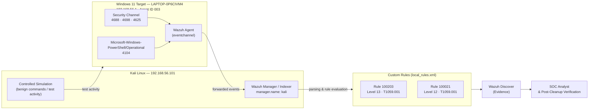

[README (5).md](https://github.com/user-attachments/files/35279883/README.5.md)

# Windows Backdoor Simulation, Persistence Detection & Removal Validation

> A controlled Windows endpoint detection-engineering Proof of Concept. Benign backdoor-like persistence and PowerShell activity is simulated on a Windows 11 endpoint, the resulting Windows Security and PowerShell telemetry is collected by **Wazuh SIEM**, parsed into structured fields, matched by custom detection rules, and finally verified clean after removal.


**Controlled Simulation → Windows Security & PowerShell Telemetry → Wazuh Parsing → Custom Rule Detection → Analyst & Post-Cleanup Verification**

> **Important:** This repository documents a **controlled, benign detection-engineering exercise** performed in an isolated laboratory. No real malware, backdoor, credential theft, or unauthorized access is involved. The scheduled tasks (`SOC_Backdoor_Sim` / `SOC_Backdoor_Sim_2`) and the PowerShell strings are deliberately harmless and exist only to generate telemetry.

---

## Table of Contents

1. [Project Overview](#1-project-overview)
2. [Objectives](#2-objectives)
3. [Scope & Evidence Classification](#3-scope--evidence-classification)
4. [Architecture](#4-architecture)
5. [Laboratory Environment](#5-laboratory-environment)
6. [Telemetry Preparation & Endpoint Auditing (Step 1)](#6-telemetry-preparation--endpoint-auditing-step-1)
7. [Process Creation & Authentication Telemetry (Steps 2, 6 & 8)](#7-process-creation--authentication-telemetry-steps-2-6--8)
8. [Controlled PowerShell Simulation & Custom Detection (Steps 3, 5 & 7)](#8-controlled-powershell-simulation--custom-detection-steps-3-5--7)
9. [Scheduled-Task Persistence & Post-Cleanup Removal Verification (Steps 4 & 9)](#9-scheduled-task-persistence--post-cleanup-removal-verification-steps-4--9)
10. [MITRE ATT&CK Mapping](#10-mitre-attck-mapping)
11. [Detection Coverage & Evidence Matrix](#11-detection-coverage--evidence-matrix)
12. [Evaluation & Security Analysis](#12-evaluation--security-analysis)
13. [Limitations & Remaining Gaps](#13-limitations--remaining-gaps)
14. [Recommended Next Steps](#14-recommended-next-steps)
15. [Suggested Repository Structure](#15-suggested-repository-structure)
16. [Reproduction Guide](#16-reproduction-guide)
17. [Security and Responsible Use](#17-security-and-responsible-use)
18. [Evidence Documentation & Portfolio Priority](#18-evidence-documentation--portfolio-priority)
19. [Project Outcome & Future Roadmap](#19-project-outcome--future-roadmap)
20. [Author](#20-author)
21. [License](#21-license)

---

## 1. Project Overview

This project is a controlled Windows endpoint detection laboratory focused on **simulating backdoor-like persistence and suspicious execution behavior**, collecting the resulting Windows Security and PowerShell telemetry with Wazuh, and validating that the events are parsed and detected by custom rules.

The project is intentionally framed as a **defensive detection-engineering exercise**. The simulated activity uses controlled, benign commands and scheduled-task names to generate telemetry without deploying an actual malicious backdoor.

### Validated Pipeline

1. **Telemetry preparation** — Process Creation auditing with command-line capture, PowerShell Script Block Logging, and Wazuh collection of the `Microsoft-Windows-PowerShell/Operational` channel.
2. **Process creation (Event ID `4688`)** — command-line and parent/child process visibility parsed by Wazuh.
3. **PowerShell Script Block Logging (Event ID `4104`)** — a distinctive benign script block is logged and collected.
4. **Custom Rule `100203`** — a Wazuh alert (Level 13, MITRE `T1059.001`) tied directly to the underlying `4104` event.
5. **Scheduled-task persistence (Event ID `4698`)** — captured natively in Windows Event Viewer and parsed in Wazuh Discover.
6. **Supporting authentication telemetry (Event ID `4625`)** — failed logon with parsed source IP.
7. **Post-cleanup verification** — elevated PowerShell checks confirm that no `SOC_Backdoor_Sim*` task remains on the endpoint.

| Item | Detail |
|---|---|
| **Author** | Labib Rahmattullah |
| **Role** | Security Operations Center (SOC) / Cybersecurity Engineer |
| **Evidence period** | 15–18 September 2026 |
| **Cleanup verified** | 23 November 2026 |
| **Environment** | Isolated virtual laboratory (Hyper-V / VirtualBox, host-only network) |

### Evidence Timeline

| Date / Time | Event | Reference |
|---|---|---|
| 15 Sep 2026 | Event ID `4688` indexed in `wazuh-alerts-4.x-2026.09.15` | Figure 4 |
| 15 Sep 2026 @ 21:20:35.966 | Rule `100021` alert (Level 12) | Figure 13 |
| 16 Sep 2026 @ 21:21:34.259 | Rule `100203` alert (Level 13) | Figure 9 |
| 16 Sep 2026 @ 21:40:59 | Event ID `4698` — `\SOC_Backdoor_Sim_2` created | Figure 7 |
| 16 Sep 2026 @ 21:50:00–22:00:00 | Event ID `4624` query window — no matching events | Figure 14 |
| 16 Sep 2026 @ 21:52:22 | Event ID `4625` — failed logon for `hacker_test` | Figure 10 |
| 23 Nov 2026 | Post-cleanup verification (Event ID `4699` query + `Get-ScheduledTask`) | Figure 15 |

---

## 2. Objectives

1. Enable and verify Windows process-creation auditing so command execution can be investigated through Event ID `4688`.
2. Enable PowerShell Script Block Logging and collect `Microsoft-Windows-PowerShell/Operational` telemetry through Wazuh.
3. Simulate a persistence mechanism using a controlled Windows Scheduled Task and capture Event ID `4698`.
4. Validate that Wazuh can parse the generated Windows events into structured `win.eventdata` and `win.system` fields.
5. Validate custom Wazuh PowerShell detection Rule `100203` against a controlled Script Block Logging event.
6. Collect supporting authentication telemetry (Event ID `4625`) and document the validation limitation observed for Event ID `4624`.
7. Document the evidence chain, validate post-cleanup removal of simulated persistence artifacts, and identify remaining gaps before the project is considered fully validated.

---

## 3. Scope & Evidence Classification

### 3.1 Scope

The scope is limited to a **single Windows 11 endpoint (`LAPTOP-0P6CIVM4`)** monitored by Wazuh in a controlled laboratory on the `192.168.56.0/24` host-only network. The project covers telemetry preparation, benign persistence simulation, detection and event parsing, post-cleanup state verification, and evidence review.

No real credential theft, malware deployment, or unauthorized access is performed.

> **Scope Clarification:** Unlike Project 1, Project 2 focuses on **endpoint detection engineering and post-cleanup verification**. The supplied Project 2 capture set does not contain a complete case-management, notification, or Active Response chain. Therefore, this project **does not claim end-to-end automated containment or SOAR/notification workflows**.

### 3.2 Evidence Classification Tiers

Every claim in this repository is tagged with one of three tiers, so that validated results are never blended with supporting telemetry or open limitations.

| Tier | Meaning | Examples in this project |
|---|---|---|
| ✅ **Validated** | Directly evidenced by a capture and central to the project's detection claim | `4688`, `4104` + Rule `100203`, `4698`, endpoint-clean verification |
| ℹ️ **Supporting / Secondary** | Real evidence, but not the primary success criterion | `4625` authentication telemetry, Rule `100021` |
| ⚠️ **Not Validated / Limitation** | Not observed, not archived, or not in the capture set; documented transparently | `4624` in queried window, archived `4699`, automated containment |

---

## 4. Architecture

### 4.1 High-Level Architecture



### 4.2 Logical Data Flow

```text
┌─────────────────────────────┐
│     Controlled Simulation   │  benign PowerShell / schtasks / ping
└──────────────┬──────────────┘
               ▼
┌─────────────────────────────┐
│ Windows Security /          │  4688 · 4698 · 4625 · 4104
│ PowerShell Event Log        │
└──────────────┬──────────────┘
               ▼
┌─────────────────────────────┐
│        Wazuh Agent          │  eventchannel collection
└──────────────┬──────────────┘
               ▼
┌─────────────────────────────┐
│       Wazuh Manager         │
└──────────────┬──────────────┘
               ▼
┌─────────────────────────────┐
│ Event Parsing & Custom Rule │  win.system / win.eventdata
│ Evaluation                  │  Rule 100203 · Rule 100021
└──────────────┬──────────────┘
               ▼
┌─────────────────────────────┐
│    Wazuh Discover Evidence  │
└──────────────┬──────────────┘
               ▼
┌─────────────────────────────┐
│ Analyst & Post-Cleanup      │  Get-ScheduledTask / 4699 query
│ Validation                  │
└─────────────────────────────┘
```

---

## 5. Laboratory Environment

### 5.1 Component Specifications

| Role | Component | Function |
|---|---|---|
| **Endpoint / Target** | Windows 11 + Wazuh Agent (`LAPTOP-0P6CIVM4`, `192.168.56.1`, Agent ID `003`) | Generates Windows Security and PowerShell events; receives controlled simulation commands |
| **SIEM / Manager** | Wazuh Manager / Indexer on Kali Linux (`192.168.56.101`) | Collects, parses, correlates, and displays endpoint telemetry |
| **Attacker / Simulation** | Kali Linux / controlled PowerShell commands | Provides the controlled simulation side and initiates test activity |
| **Detection Layer** | Custom Wazuh local rules | Maps observed events to detection logic and MITRE ATT&CK context |

### 5.2 Network Design

- Isolated virtual laboratory on **Hyper-V / VirtualBox** with a **host-only network**.
- Lab subnet: `192.168.56.0/24`.
- The Kali host (`192.168.56.101`) acts as both the simulation side and the Wazuh Manager/Indexer; it is also the source IP observed in the failed-logon telemetry (Event ID `4625`).
- No internet-facing exposure and no production assets are involved.

---

## 6. Telemetry Preparation & Endpoint Auditing (Step 1)

Before simulating persistence, Windows auditing was configured to record process creation and command-line context. PowerShell Script Block Logging was also enabled, and the Wazuh Agent was configured to collect the `Microsoft-Windows-PowerShell/Operational` channel.

### 6.1 Process Creation Auditing — Figure 1

```powershell
auditpol /set /subcategory:"Process Creation" /success:enable /failure:enable

New-ItemProperty -Path "HKLM:\SOFTWARE\Microsoft\Windows\CurrentVersion\Policies\System\Audit" `
    -Name "ProcessCreationIncludeCmdLine_Enabled" -Value 1 -PropertyType DWord -Force
```

Figure 1 shows successful execution of the audit policy command and the registry value `ProcessCreationIncludeCmdLine_Enabled = 1`. This is the prerequisite for useful Event ID `4688` telemetry.


### 6.2 PowerShell Script Block Logging — Figure 2

```powershell
New-Item -Path "HKLM:\SOFTWARE\Policies\Microsoft\Windows\PowerShell\ScriptBlockLogging" `
    -Force -ErrorAction SilentlyContinue | Out-Null

Set-ItemProperty -Path "HKLM:\SOFTWARE\Policies\Microsoft\Windows\PowerShell\ScriptBlockLogging" `
    -Name "EnableScriptBlockLogging" -Value 1 -Type DWord
```

Figure 2 shows `EnableScriptBlockLogging = 1` under the PowerShell ScriptBlockLogging policy path, enabling the Script Block Logging required for Event ID `4104` evidence.


### 6.3 Wazuh Agent PowerShell Operational Channel — Figure 3

```powershell
$newConfig = @"
<localfile>
<location>Microsoft-Windows-PowerShell/Operational</location>
<log_format>eventchannel</log_format>
</localfile>
"@

$content = Get-Content $confPath
if ($content -notmatch "Microsoft-Windows-PowerShell/Operational") {
    $insertIndex = [array]::IndexOf($content, "</ossec_config>")
    if ($insertIndex -ge 0) {
        $newContent = $content[0..($insertIndex-1)] + $newConfig + $content[$insertIndex..($content.Length-1)]
        $newContent | Set-Content $confPath -Force
        Restart-Service -Name "wazuh"
        Write-Host "[+] Konfigurasi PowerShell berhasil diinjeksi dan Wazuh Agent telah di-restart!" -ForegroundColor Green
    }
}
```

> The status message is in Indonesian and reads: *"PowerShell configuration successfully injected and Wazuh Agent has been restarted!"*
> `$confPath` is defined earlier in the original session and is not shown in the capture; see the [Reproduction Guide](#16-reproduction-guide).

Figure 3 shows the Wazuh `eventchannel` configuration for `Microsoft-Windows-PowerShell/Operational`, the collection path used for the subsequent `4104` evidence.


---

## 7. Process Creation & Authentication Telemetry (Steps 2, 6 & 8)

### 7.1 Process Creation — Event ID `4688` (Step 2, Figure 4)

The capture shows Event ID `4688` with `commandLine` `ping 8.8.8.8 -n 1`, `newProcessName` `PING.EXE`, and `parentProcessName` `cmd.exe`.

| Wazuh Discover Field | Parsed Telemetry Value |
|---|---|
| `_index` | `wazuh-alerts-4.x-2026.09.15` |
| `agent.id` / `agent.ip` / `agent.name` | `003` / `192.168.56.1` / `LAPTOP-0P6CIVM4` |
| `data.win.eventdata.commandLine` | `ping 8.8.8.8 -n 1` |
| `data.win.eventdata.newProcessName` | `C:\Windows\System32\PING.EXE` (PID: `0x319c`) |
| `data.win.eventdata.parentProcessName` | `C:\Windows\System32\cmd.exe` (PID: `0x222c`) |
| `data.win.eventdata.subjectUserName` | `acer` (Domain: `LAPTOP-0P6CIVM4`) |
| `data.win.system.channel` / `eventID` | `Security` / `4688` (RecordID: `1147713`) |


> **Interpretation:** This is strong evidence that Event ID `4688` is parsed by Wazuh and that command-line and parent/child process fields are available. Because the observed command is benign, the event is **telemetry-validation evidence, not proof of malicious execution**.

### 7.2 Failed Authentication — Event ID `4625` (Step 6, Figures 10–12) — ℹ️ Supporting

Event ID `4625` captures show failed authentication for `hacker_test` with Logon Type `3` and Wazuh-parsed source-IP information. They are **supporting telemetry**, not the core persistence detection.

| Capture | Source | Telemetry Summary |
|---|---|---|
| Figure 10 | Native Windows `4625` | An account failed to log on · Account Name: `hacker_test` · Domain: `LAPTOP-0P6CIVM4` · Logon Type: `3` · Logged: `16/09/2026 21:52:22` |
| Figure 11 | Wazuh parsed `4625` | `channel`: Security · `eventID`: 4625 · `severityValue`: AUDIT_FAILURE · `targetUserName`: `hacker_test` · RecordID: `1162023` |
| Figure 12 | Wazuh source IP | `ipAddress`: `192.168.56.101` · `ipPort`: `55806` · `authenticationPackageName`: NTLM · `status`: `0xc000006d` · `subStatus`: `0xc0000064` |


> **Interpretation:** The three captures provide complementary views — native Event Viewer, structured Wazuh fields, and the source IP `192.168.56.101`. A single `4625` event does not establish a successful compromise; it only proves a **failed** authentication attempt.

### 7.3 Successful Logon Limitation — Event ID `4624` (Step 8, Figure 14) — ⚠️ Limitation

```powershell
Get-WinEvent -FilterHashtable @{
    LogName   = 'Security'
    ID        = 4624
    StartTime = [datetime]"2026-09-16 21:50:00"
    EndTime   = [datetime]"2026-09-16 22:00:00"
} | Select-Object TimeCreated, Id,
    @{Name='UserName';  Expression={$_.Properties[5].Value}},
    @{Name='LogonType'; Expression={$_.Properties[8].Value}} |
    Format-Table -AutoSize
```

Result:

```text
Get-WinEvent : No events were found that match the specified selection criteria.
+ FullyQualifiedErrorId : NoMatchingEventsFound,Microsoft.PowerShell.Commands.GetWinEventCommand
```


> **Interpretation:** This is a valid laboratory finding and is reported as a **limitation** rather than replaced with an assumed successful logon. The absence of `4624` in this test does **not** mean `4624` is technically unable to traverse Wazuh; it only establishes that no matching event was found for the queried interval.

---

## 8. Controlled PowerShell Simulation & Custom Detection (Steps 3, 5 & 7)

### 8.1 Controlled Simulation (Step 3, Figure 5)

A benign PowerShell command simulates an attacker-like message **without executing an actual post-exploitation framework**. The text states that the simulated attacker executed *PowerView* and *PowerUp* for network mapping.

```powershell
Invoke-Command -ScriptBlock { Write-Host "Penyerang berhasil masuk. Mengeksekusi PowerView dan PowerUp untuk memetakan jaringan." }
```

> The string is in Indonesian and reads: *"The attacker successfully got in. Executing PowerView and PowerUp to map the network."*

The text is intentionally distinctive, which makes it useful for testing Script Block Logging. It is a **simulated command string only**; no PowerView or PowerUp binaries were executed.


### 8.2 Primary Custom Detection — Rule `100203` (Step 5, Figure 9) — ✅ Validated

A PowerShell Script Block event (Event ID `4104`) was parsed by Wazuh and generated a custom Rule `100203` alert mapped to MITRE ATT&CK `T1059.001`.

| Wazuh Alert Field | Detection & Payload Metadata |
|---|---|
| `rule.id` | `100203` |
| `rule.level` | `13` |
| `rule.firedtimes` | `2` |
| `rule.mail` | `true` |
| `rule.description` | `CRITICAL: Risky PowerShell CMDLet executed. Possible malicious activity detected.` |
| `rule.mitre.id` / tactic / technique | `T1059.001` / Execution / PowerShell |
| `location` | `EventChannel` |
| `manager.name` | `kali` |
| `timestamp` | `Sep 16, 2026 @ 21:21:34.259` |
| `full_log` (`scriptBlockText`) | EventID `4104` (`Microsoft-Windows-PowerShell/Operational`): `{ Write-Host "Penyerang berhasil masuk. Mengeksekusi PowerView dan PowerUp untuk memetakan jaringan." }` |


> **Why this matters:** Figure 9 directly connects the underlying `4104` `scriptBlockText` payload to Rule ID `100203`, Level 13, and MITRE `T1059.001`. It supports the claim that the custom rule was **actually triggered, not merely configured**. It is the strongest Project 2 capture.

### 8.3 Secondary Detection — Rule `100021` (Step 7, Figure 13) — ℹ️ Secondary

| Wazuh Alert Field | Secondary Rule Details |
|---|---|
| `rule.id` | `100021` |
| `rule.level` | `12` |
| `rule.firedtimes` | `17` |
| `rule.description` | `Suspicious PowerShell Execution Detected` (MITRE `T1059.001` – Execution) |
| `timestamp` | `Sep 15, 2026 @ 21:20:35.966` |
| `full_log` | EventID `4104` — `ScriptBlockText` validation string |


Rule `100021` shows that the same endpoint telemetry can feed **multiple detection rules**. It is **not** the primary success criterion, because the core custom detection demonstrated in this capture set is Rule `100203`.

---

## 9. Scheduled-Task Persistence & Post-Cleanup Removal Verification (Steps 4 & 9)

### 9.1 Persistence Creation — Event ID `4698` (Step 4, Figures 6–8) — ✅ Validated

A scheduled task named `SOC_Backdoor_Sim` was created with `schtasks` as a daily task running a benign command containing the MITRE technique reference `T1053.005`.

```powershell
schtasks /create /tn "SOC_Backdoor_Sim" /tr "cmd.exe /c echo 'MITRE T1053.005'" /sc daily /st 00:00
# SUCCESS: The scheduled task "SOC_Backdoor_Sim" has successfully been created.
```

**Figure 6** confirms successful creation and serves as the setup-side evidence.


**Figure 7 — Native Windows Security Event ID `4698`:**

| Attribute | Recorded Event Details |
|---|---|
| Log Name / Source | `Security` / Microsoft Windows security auditing |
| Event ID / Logged Timestamp | `4698` (Audit Success) / `16/09/2026 21:40:59` |
| Computer / Subject Account | `LAPTOP-0P6CIVM4` / `LAPTOP-0P6CIVM4\acer` (Logon ID: `0x72F162A`) |
| Task Name / XML Author URI | `\SOC_Backdoor_Sim_2` (CalendarTrigger StartBoundary: `2026-09-16T00:00:00`) |


> Event ID `4698` is the key endpoint-side evidence that a scheduled task was created, and it exposes the full XML task definition.

**Figure 8 — Wazuh Discover parsing of Event ID `4698`:**

| Wazuh Discover Field | Parsed Persistence Telemetry |
|---|---|
| `data.win.eventdata.taskName` | `\SOC_Backdoor_Sim_2` |
| `data.win.system.channel` / `computer` | `Security` / `LAPTOP-0P6CIVM4` |
| `data.win.system.eventID` | `4698` (RecordID: `1161963`) |
| `data.win.system.message` | A scheduled task was created. (Author: `LAPTOP-0P6CIVM4\acer`, DaysInterval: `1`) |


The structured field `win.eventdata.taskName` contains `SOC_Backdoor_Sim_2` and the event is visible under the `Security` channel, confirming that `4698` was received and parsed by Wazuh.

### 9.2 Post-Cleanup Removal Verification (Step 9, Figure 15) — ✅ Endpoint Verified Clean

On **23 November 2026**, two verification queries were executed in an elevated PowerShell session to confirm that `SOC_Backdoor_Sim` and `SOC_Backdoor_Sim_2` were completely removed from the endpoint:

```powershell
# Check 1 — Historical Security log filter for scheduled-task deletion events (Event ID 4699)
Get-WinEvent -FilterHashtable @{LogName='Security'; ID=4699} -ErrorAction SilentlyContinue |
    Where-Object { $_.Message -match "SOC_Backdoor_Sim" } |
    Format-List TimeCreated, Id, Message

# Check 2 — Active Task Scheduler state inspection
Get-ScheduledTask -TaskName "SOC_Backdoor_Sim*"
```


| # | Check | Result | Interpretation |
|---|---|---|---|
| 1 | Event ID `4699` historical query for `SOC_Backdoor_Sim` | **No records returned** | The mid-September 2026 deletion event had already **rotated out of the local Windows Security log retention window** |
| 2 | `Get-ScheduledTask -TaskName "SOC_Backdoor_Sim*"` | **Zero objects returned** | No simulated persistence tasks remain active or present on `LAPTOP-0P6CIVM4` |

> **Evidence integrity note:** Check 1 returning empty is **not** proof of deletion by itself. The removal claim rests on **Check 2** (live Task Scheduler state). The original September `4699` deletion log was not archived before Windows Security log rollover, and this is documented as a limitation in [Section 13](#13-limitations--remaining-gaps).

---

## 10. MITRE ATT&CK Mapping

| Technique | Tactic | Description | Evidence / Detection | Status |
|---|---|---|---|---|
| `T1059.001` | Execution | Command and Scripting Interpreter: PowerShell | Event ID `4104` → Rule `100203` (Level 13) and Rule `100021` (Level 12) | ✅ Validated (`100203`) / ℹ️ Secondary (`100021`) |
| `T1053.005` | Persistence | Scheduled Task/Job: Scheduled Task | Event ID `4698` — `SOC_Backdoor_Sim` / `\SOC_Backdoor_Sim_2` | ✅ Validated (endpoint + Wazuh parsing) |
| — | Authentication context | Failed authentication (supporting context only) | Event ID `4625` — `hacker_test`, Logon Type `3`, source `192.168.56.101` | ℹ️ Supporting telemetry |

---

## 11. Detection Coverage & Evidence Matrix

| Event / Rule | Purpose | Evidence in Capture Set | Validation |
|---|---|---|---|
| `4688` | Process creation / command-line visibility | Figure 4 | ✅ **Validated telemetry** |
| `4104` | PowerShell Script Block Logging | Figure 9 | ✅ **Validated + Rule `100203` fired** |
| `4698` | Scheduled task creation / persistence | Figures 6–8 | ✅ **Validated endpoint + Wazuh parsing** |
| `4625` | Failed authentication support | Figures 10–12 | ℹ️ **Validated event telemetry** (supporting) |
| `100203` | Risky PowerShell Cmdlet detection | Figure 9 | ✅ **Validated alert** |
| `100021` | Secondary PowerShell alert | Figure 13 | ℹ️ Observed alert; secondary |
| `4624` | Successful logon validation | Figure 14 | ⚠️ **Not observed in queried window** |
| Backdoor removal | Removal / cleanup proof | Figure 15 | ✅ **Endpoint state verified clean** (historical deletion log outside retention window) |

### 11.1 Current Validation Status

Based strictly on the supplied captures, Project 2 has a solid telemetry and detection foundation. The strongest validated chain is:

**PowerShell / Windows activity → Event Log → Wazuh parsing → Rule `100203` alert**

The scheduled-task persistence simulation is directly evidenced by Event ID `4698`, and post-cleanup verification (Figure 15) confirms that the endpoint is clean of any remaining `SOC_Backdoor_Sim*` tasks. However, the original September Event ID `4699` deletion log was not archived prior to Windows Security log rollover, and a successful authentication event (`4624`) was not captured within the queried interval.

---

## 12. Evaluation & Security Analysis

### 12.1 Evaluation

| Metric | Observed Result | Assessment |
|---|---|---|
| Process telemetry | Event ID `4688` parsed with `commandLine` and parent/new process fields | ✅ Validated |
| PowerShell telemetry | Event ID `4104` visible through Wazuh | ✅ Validated |
| Scheduled-task persistence | Event ID `4698` captured natively and in Wazuh | ✅ Validated |
| Custom detection | Rule `100203` fired on supplied `4104` evidence | ✅ Validated |
| Authentication failure | Event ID `4625` captured and parsed | ✅ Validated / supporting |
| Successful authentication | No matching Event ID `4624` in queried interval | ⚠️ Not validated |
| Backdoor removal | Post-removal check (Figure 15) confirmed zero active `SOC_Backdoor_Sim*` tasks; original September deletion log was not archived prior to log rollover | ✅ Endpoint verified clean (manual removal confirmed) |
| Automated containment | No Project 2 Active Response proof in supplied capture set | ⚠️ Not validated |

### 12.2 Engineering Takeaways

- **Event ID `4688`** provides process execution context and becomes substantially more useful when command-line auditing is enabled.
- **Event ID `4104`** provides Script Block Logging visibility that supports PowerShell-focused detection engineering.
- **Event ID `4698`** is a strong persistence indicator because it records creation of a scheduled task and exposes full XML task metadata.
- **Rule `100203`** is the strongest demonstrated custom detection because the Wazuh alert can be tied directly to an underlying `4104` event.
- The supplied evidence intentionally uses **benign simulation**; the report distinguishes malicious-looking telemetry from actual malware execution.
- **Post-cleanup verification** via `Get-ScheduledTask` (Figure 15) confirms that no simulated persistence artifacts remain, while demonstrating why **deletion events (Event ID `4699`) must be ingested into Wazuh in real time, before local Windows Security logs roll over.** Without real-time ingestion, the audit trail for task removal can be lost and only the live endpoint state remains as proof.
- The absence of Event ID `4624` in the queried period is documented as an **evidence limitation**, not as proof that Windows or Wazuh cannot generate or forward `4624`.

---

## 13. Limitations & Remaining Gaps

1. **Event ID `4699` not archived** — the original mid-September 2026 scheduled-task deletion event was not captured natively or in Wazuh Discover before the local Windows Security log rolled over. Removal is proven by the live `Get-ScheduledTask` state (Figure 15), not by an archived deletion event.
2. **Event ID `4624` not observed** — the `Get-WinEvent` query for `2026-09-16 21:50:00` to `22:00:00` returned `NoMatchingEventsFound` (Figure 14). Successful-logon telemetry remains unvalidated.
3. **Rule `100203` XML definition not in the capture set** — the alert (Figure 9) is evidenced, but the rule configuration is not captured alongside it, so the *configuration → event → detection* chain is incomplete.
4. **No benign false-positive test documented** — it has not been recorded whether Rule `100203` fires when the suspicious cmdlet terms are absent.
5. **No Project 2 automated containment** — no Active Response proof exists in the supplied capture set. Cleanup was verified as a **manual removal**.

> This project should **not** yet be described as a fully validated end-to-end automated incident-response workflow.

---

## 14. Recommended Next Steps

1. **Ingest `4699` in real time** — capture Event ID `4699` natively and in Wazuh Discover immediately upon task deletion, before Windows Security log rollover occurs, if live SIEM ingestion of scheduled-task deletion telemetry is required for end-to-end audit trails.
2. **Run a controlled `4624` login test** — capture a clean successful-logon event if successful-authentication telemetry is required by the detection hypothesis.
3. **Document the Rule `100203` XML** — capture the Wazuh XML rule configuration alongside the triggered alert so the project demonstrates configuration → event → detection.
4. **Perform a benign false-positive baseline** — run at least one benign PowerShell test and record whether Rule `100203` fires when the suspicious cmdlet terms are absent.
5. **Stay focused** — the goal is evidence quality and detection validation, not the number of custom rules.

---

## 15. Suggested Repository Structure

```text
windows-backdoor-persistence-detection/
├── README.md
├── LICENSE
├── SECURITY.md
├── docs/
│   ├── evidence-matrix.md
│   ├── limitations-and-next-steps.md
│   └── project-2-report.pdf
├── scripts/
│   ├── 01-enable-telemetry.ps1          # auditpol, registry, Script Block Logging, ossec.conf injection
│   ├── 02-benign-simulation.ps1         # ping, PowerShell simulation string, schtasks creation
│   └── 03-post-cleanup-verification.ps1 # 4699 historical query + Get-ScheduledTask check
├── configs/
│   ├── ossec-powershell-localfile.xml   # <localfile> eventchannel snippet
│   └── local_rules.xml                  # custom rules (100203 definition to be added — see Section 14)
└── assets/
    └── images/
        ├── fig01-process-creation-auditing.png
        ├── fig02-script-block-logging.png
        ├── fig03-wazuh-powershell-eventchannel.png
        ├── fig04-wazuh-event-4688.png
        ├── fig05-benign-powershell-simulation.png
        ├── fig06-scheduled-task-creation.png
        ├── fig07-native-event-4698.png
        ├── fig08-wazuh-event-4698.png
        ├── fig09-rule-100203-alert.png
        ├── fig10-native-4625.png
        ├── fig11-wazuh-4625-parsed.png
        ├── fig12-wazuh-4625-source-ip.png
        ├── fig13-rule-100021-alert.png
        ├── fig14-4624-no-matching-events.png
        └── fig15-post-cleanup-verification.png
```

---

## 16. Reproduction Guide

> **Warning:** Run these steps **only on systems you own or are explicitly authorized to test**, inside an isolated lab. All commands below are benign and generate telemetry only. Run PowerShell as **Administrator**.

### Step 1 — Enable Telemetry (Windows endpoint)

```powershell
# 1a. Process Creation auditing with command-line capture
auditpol /set /subcategory:"Process Creation" /success:enable /failure:enable
New-ItemProperty -Path "HKLM:\SOFTWARE\Microsoft\Windows\CurrentVersion\Policies\System\Audit" `
    -Name "ProcessCreationIncludeCmdLine_Enabled" -Value 1 -PropertyType DWord -Force

# 1b. PowerShell Script Block Logging
New-Item -Path "HKLM:\SOFTWARE\Policies\Microsoft\Windows\PowerShell\ScriptBlockLogging" -Force -ErrorAction SilentlyContinue | Out-Null
Set-ItemProperty -Path "HKLM:\SOFTWARE\Policies\Microsoft\Windows\PowerShell\ScriptBlockLogging" `
    -Name "EnableScriptBlockLogging" -Value 1 -Type DWord

# 1c. Collect the PowerShell Operational channel in the Wazuh Agent
# ASSUMPTION: default agent path; $confPath is not shown in the original capture. Adjust to your install.
$confPath = "C:\Program Files (x86)\ossec-agent\ossec.conf"
$newConfig = @"
<localfile>
<location>Microsoft-Windows-PowerShell/Operational</location>
<log_format>eventchannel</log_format>
</localfile>
"@
$content = Get-Content $confPath
if ($content -notmatch "Microsoft-Windows-PowerShell/Operational") {
    $insertIndex = [array]::IndexOf($content, "</ossec_config>")
    if ($insertIndex -ge 0) {
        $newContent = $content[0..($insertIndex-1)] + $newConfig + $content[$insertIndex..($content.Length-1)]
        $newContent | Set-Content $confPath -Force
        Restart-Service -Name "wazuh"
    }
}
```

### Step 2 — Generate Process Creation Telemetry (`4688`)

```cmd
ping 8.8.8.8 -n 1
```

### Step 3 — Run the Benign PowerShell Simulation (`4104`)

```powershell
Invoke-Command -ScriptBlock { Write-Host "Penyerang berhasil masuk. Mengeksekusi PowerView dan PowerUp untuk memetakan jaringan." }
```

### Step 4 — Create the Simulated Persistence Task (`4698`)

```powershell
schtasks /create /tn "SOC_Backdoor_Sim" /tr "cmd.exe /c echo 'MITRE T1053.005'" /sc daily /st 00:00
```

> The native `4698` capture (Figure 7) shows the task name `\SOC_Backdoor_Sim_2`. The command that created the `_2` task is not shown in the capture set; repeat Step 4 with `/tn "SOC_Backdoor_Sim_2"` to reproduce it.

### Step 5 — Verify in Wazuh Discover

Suggested filters (field names as observed in the captures):

```text
data.win.system.eventID: 4688
data.win.system.eventID: 4698 AND data.win.eventdata.taskName: *SOC_Backdoor_Sim*
rule.id: 100203
rule.id: 100021
data.win.system.eventID: 4625
```

### Step 6 — Failed Authentication Telemetry (`4625`, optional, supporting)

Generate a single failed network logon (Logon Type `3`) from the lab simulation host against an account that does not exist. The exact tool used for Figures 10–12 is not documented in the report. Expected result: Event ID `4625` with the source IP of the simulation host.

### Step 7 — Remove the Simulated Persistence and Verify

```powershell
# Cleanup (the report documents manual removal but does not capture the delete command)
schtasks /delete /tn "SOC_Backdoor_Sim"   /f
schtasks /delete /tn "SOC_Backdoor_Sim_2" /f

# Post-cleanup verification (Figure 15)
Get-WinEvent -FilterHashtable @{LogName='Security'; ID=4699} -ErrorAction SilentlyContinue |
    Where-Object { $_.Message -match "SOC_Backdoor_Sim" } |
    Format-List TimeCreated, Id, Message

Get-ScheduledTask -TaskName "SOC_Backdoor_Sim*"    # expected: no output
```

> If you run the `4699` query **immediately** after deletion, the event should still be present in the local Security log. Capture it in Wazuh Discover at that point — this is the gap documented in [Section 13](#13-limitations--remaining-gaps).

---

## 17. Security and Responsible Use

- Use this project for **defensive, blue-team, and educational purposes only**.
- Perform all testing in an **isolated laboratory** on systems you own or are explicitly authorized to assess.
- Never deploy the simulated scheduled tasks or script strings on production or third-party systems.
- **Do not** replace the benign simulation with real malware, real post-exploitation tooling, or real credential-theft techniques.
- Use dedicated lab accounts only. The account `hacker_test` is a lab-only, throwaway identity.
- **Credential hygiene:** never commit passwords, API keys, tokens, agent registration keys, or real hostnames/IPs from production environments to the repository. Review every screenshot before publishing and redact sensitive values.
- Keep the lab on a **host-only network** with no exposure to the internet or corporate networks.
- Report any security issues with this repository through `SECURITY.md`.

---

## 18. Evidence Documentation & Portfolio Priority

### 18.1 Figure Index

| Figure | Description | Section |
|---|---|---|
| Figure 1 | Windows Process Creation Auditing Configuration | [6.1](#61-process-creation-auditing--figure-1) |
| Figure 2 | PowerShell Script Block Logging Configuration | [6.2](#62-powershell-script-block-logging--figure-2) |
| Figure 3 | Wazuh Agent PowerShell Operational EventChannel Configuration | [6.3](#63-wazuh-agent-powershell-operational-channel--figure-3) |
| Figure 4 | Wazuh Discover — Windows Event ID `4688` Process Creation | [7.1](#71-process-creation--event-id-4688-step-2-figure-4) |
| Figure 5 | Benign PowerShell Simulation Command | [8.1](#81-controlled-simulation-step-3-figure-5) |
| Figure 6 | Scheduled Task Persistence Simulation | [9.1](#91-persistence-creation--event-id-4698-step-4-figures-68--validated) |
| Figure 7 | Native Windows Event ID `4698` — Scheduled Task Created | [9.1](#91-persistence-creation--event-id-4698-step-4-figures-68--validated) |
| Figure 8 | Wazuh Discover — Event ID `4698` and `SOC_Backdoor_Sim_2` | [9.1](#91-persistence-creation--event-id-4698-step-4-figures-68--validated) |
| Figure 9 | Wazuh Discover — Rule `100203` PowerShell Detection | [8.2](#82-primary-custom-detection--rule-100203-step-5-figure-9---validated) |
| Figure 10 | Native Windows Event ID `4625` | [7.2](#72-failed-authentication--event-id-4625-step-6-figures-1012---supporting) |
| Figure 11 | Wazuh Parsed `4625` | [7.2](#72-failed-authentication--event-id-4625-step-6-figures-1012---supporting) |
| Figure 12 | Wazuh Source IP `192.168.56.101` for `4625` | [7.2](#72-failed-authentication--event-id-4625-step-6-figures-1012---supporting) |
| Figure 13 | Wazuh Discover — Rule `100021` PowerShell Alert | [8.3](#83-secondary-detection--rule-100021-step-7-figure-13---secondary) |
| Figure 14 | Validation Attempt for Event ID `4624` — No Matching Events | [7.3](#73-successful-logon-limitation--event-id-4624-step-8-figure-14---limitation) |
| Figure 15 | Post-Cleanup PowerShell Verification — `4699` Historical Query & `Get-ScheduledTask` State Check | [9.2](#92-post-cleanup-removal-verification-step-9-figure-15---endpoint-verified-clean) |

### 18.2 Portfolio Priority Ranking

| Priority | Capture | Why Use It |
|---|---|---|
| 1 | Figure 9 — Rule `100203` | Best proof of custom detection actually firing from `4104` telemetry |
| 2 | Figure 7 — Native `4698` | Direct Windows evidence of scheduled-task persistence creation |
| 3 | Figure 8 — Wazuh `4698` | Shows Wazuh successfully parsing the persistence event |
| 4 | Figure 4 — Wazuh `4688` | Demonstrates process creation and command-line visibility |
| 5 | Figure 2 — Script Block Logging | Shows telemetry prerequisite for `4104` |
| 6 | Figure 3 — Wazuh PowerShell channel | Shows collection configuration |
| 7 | Figure 6 — Scheduled task command | Shows controlled simulation setup |
| 8 | Figure 15 — Post-cleanup removal check | Confirms endpoint is verified clean of simulated scheduled-task persistence artifacts |
| 9 | Figures 10–12 — Event ID `4625` | Useful supporting authentication evidence |
| 10 | Figure 14 — `4624` query failure | Use only in limitations / troubleshooting section |
| 11 | Figure 13 — Rule `100021` | Optional secondary detection evidence |

---

## 19. Project Outcome & Future Roadmap

### 19.1 Project Outcome

Project 2 successfully established the **core Windows telemetry pipeline** needed for endpoint detection engineering: process creation visibility (`4688`), PowerShell Script Block Logging (`4104`), scheduled-task creation (`4698`), failed authentication telemetry (`4625`), a custom Wazuh Rule `100203` alert tied to PowerShell activity, and post-cleanup verification confirming removal of the simulated scheduled tasks. These results provide a credible foundation for a Windows persistence/backdoor detection laboratory.

```text
Benign Simulation (PowerShell string · schtasks · ping)
        │
        ▼
Windows Event Log  ──  4688 · 4104 · 4698 · 4625
        │
        ▼
Wazuh Agent (eventchannel) ──► Wazuh Manager
        │
        ▼
Parsing (win.system / win.eventdata)
        │
        ├──► Rule 100203 (L13, T1059.001)   ✅ Validated
        ├──► Rule 100021 (L12, T1059.001)   ℹ️ Secondary
        └──► Event 4698 (T1053.005)         ✅ Validated
        │
        ▼
Wazuh Discover Evidence
        │
        ▼
Analyst Review
        │
        ▼
Manual Removal ──► Get-ScheduledTask "SOC_Backdoor_Sim*" = 0 objects  ✅ Endpoint clean
                   Event 4699 historical query = empty (log rolled over) ⚠️ Limitation
```

### 19.2 Portfolio Roadmap

| Project | Focus | Status |
|---|---|---|
| **Project 1** | SOC detection & automated response lab | ✅ Completed / Validated |
| **Project 2** | Windows backdoor simulation, persistence detection & removal validation (this repository) | ✅ Completed / Validated (core pipeline; see [Section 13](#13-limitations--remaining-gaps)) |
| **Project 3** | DFIR / Incident Investigation | 🔜 Planned |
| **Project 4** | Mini Enterprise SOC | 🔜 Planned |

---

## 20. Author

**Labib Rahmattullah**
SOC / Cybersecurity Engineer

- LinkedIn: [linkedin.com/in/labib-rahmattullah](https://linkedin.com/in/labib-rahmattullah)
- GitHub: [github.com/labibrahmattullah](https://github.com/labibrahmattullah)

---

## 21. License

This project is licensed under the **MIT License**. See the [LICENSE](LICENSE) file for details.

```text
MIT License

Copyright (c) 2026 Labib Rahmattullah

Permission is hereby granted, free of charge, to any person obtaining a copy
of this software and associated documentation files (the "Software"), to deal
in the Software without restriction, including without limitation the rights
to use, copy, modify, merge, publish, distribute, sublicense, and/or sell
copies of the Software, and to permit persons to whom the Software is
furnished to do so, subject to the following conditions:

The above copyright notice and this permission notice shall be included in all
copies or substantial portions of the Software.

THE SOFTWARE IS PROVIDED "AS IS", WITHOUT WARRANTY OF ANY KIND, EXPRESS OR
IMPLIED, INCLUDING BUT NOT LIMITED TO THE WARRANTIES OF MERCHANTABILITY,
FITNESS FOR A PARTICULAR PURPOSE AND NONINFRINGEMENT. IN NO EVENT SHALL THE
AUTHORS OR COPYRIGHT HOLDERS BE LIABLE FOR ANY CLAIM, DAMAGES OR OTHER
LIABILITY, WHETHER IN AN ACTION OF CONTRACT, TORT OR OTHERWISE, ARISING FROM,
OUT OF OR IN CONNECTION WITH THE SOFTWARE OR THE USE OR OTHER DEALINGS IN THE
SOFTWARE.
```
